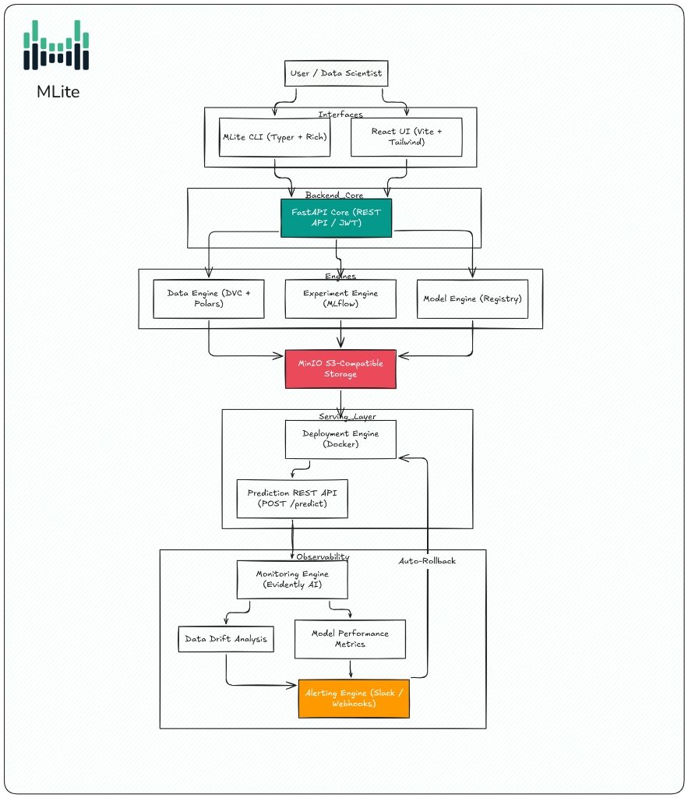

<div align="center">


# MLite

### *Lightweight Self-Hosted MLOps Platform*

<!-- Badges Section -->
<p align="center">
  <a href="LICENSE">
    
  </a>
  <a href="https://python.org">
    
  </a>
  <a href="docker-compose.yml">
    
  </a>
  <a href="CONTRIBUTING.md">
    
  </a>
</p>

<p align="center">
  
  
  
  
  
  
  
</p>

<p align="center">
  <a href="#features">Features</a> •
  <a href="#quick-start">Quick Start</a> •
  <a href="#architecture">Architecture</a> •
  <a href="#tech-stack">Tech Stack</a> •
  <a href="CONTRIBUTING.md">Contributing</a>
</p>

</div>

---

MLite is an open-source, self-hosted MLOps platform for small teams and
researchers. It provides a web dashboard, a REST API, and an optional CLI for
working with datasets, experiments, model versions, and Docker inference services.

## Features

| Area | What MLite provides |
| --- | --- |
| Datasets | CSV, Parquet, and JSON uploads, schema inspection, and SHA-256 version fingerprints. DVC commands are available for Git-based workflows. |
| Experiments | Inspect MLflow runs and their metrics in the dashboard. Training runs in your own Python environment or pipeline. |
| Model Registry | Register a model from a run, sync its metrics, inspect its lineage when available, and manage version stages. Production promotion checks the model artifact and input signature. |
| Deployments | Run registered models in dedicated Docker containers with prediction and readiness endpoints. Rollback checks the target version before stopping the previous container. |
| Monitoring | Compare selected reference and current datasets, download drift reports, and view inference latency when telemetry is available. |
| Alerts | Configure rules and delivery channels. Periodic evaluation of alert rules and rollback policies is opt-in. |

## Quick Start

From a machine with Docker and Docker Compose v2:

```bash
git clone https://github.com/Youssef-Laaroussi/MLOpsLite.git
cd MLOpsLite
docker compose up -d --build
docker compose ps
```

Open the [dashboard](http://localhost:3000). On a fresh installation, MLite opens
the setup screen. Read the single-use installation code with
`docker compose logs mlite-api`, then create your personal account. It becomes
administrator of this installation; the same account owns the projects you create.
Open **profile menu → Administration** (or `/admin`) to manage the instance.

Existing installations keep their accounts and data. Follow the
[Solo setup and migration guide](docs/getting-started/solo-setup.md) to explicitly
select the personal administrator and assign projects without an owner.
To train and serve your first model, follow the [Iris walkthrough](examples/iris/README.md).
It covers building the serving image, configuring artifact storage, and testing a
prediction and a drift report.

### CLI

Use the CLI included in the running API container:

```bash
docker compose exec mlite-api mlite --help
```

For direct terminal access with `mlite`, see the
[local CLI installation instructions](docs/getting-started/installation.md).

## Architecture

<p align="center">
  
</p>

---

## Tech Stack

```text
Language:             Python 3.12+
API Framework:        FastAPI & Pydantic v2
CLI Tooling:          Typer & Rich
Database:             PostgreSQL 16 with SQLAlchemy 2.0 (asyncpg)
Object Storage:       MinIO (S3-compatible, self-hosted)
Experiment Tracking:  MLflow 2.15+
Data Processing:      Polars & DVC
ML Observability:     Evidently AI
Frontend:             React 18, TypeScript, Tailwind CSS, Recharts
Containerization:     Docker & Docker Compose v2
Testing & Quality:    Pytest, Ruff, MyPy
```

---

## Contributing

We welcome community contributions! Please read our guidelines before opening pull requests:

1. **[Contributing Guide](CONTRIBUTING.md)**: Branch conventions, environment setup, PR checklist.
2. **[Code of Conduct](CODE_OF_CONDUCT.md)**: Community standards.

> [!IMPORTANT]
> **Branch Strategy**: All pull requests must target the **`dev`** branch (`feature/*` -> `dev`). The **`main`** branch is protected and strictly reserved for stable production releases.

---

## License

This project is licensed under the **[Apache License 2.0](LICENSE)**.
